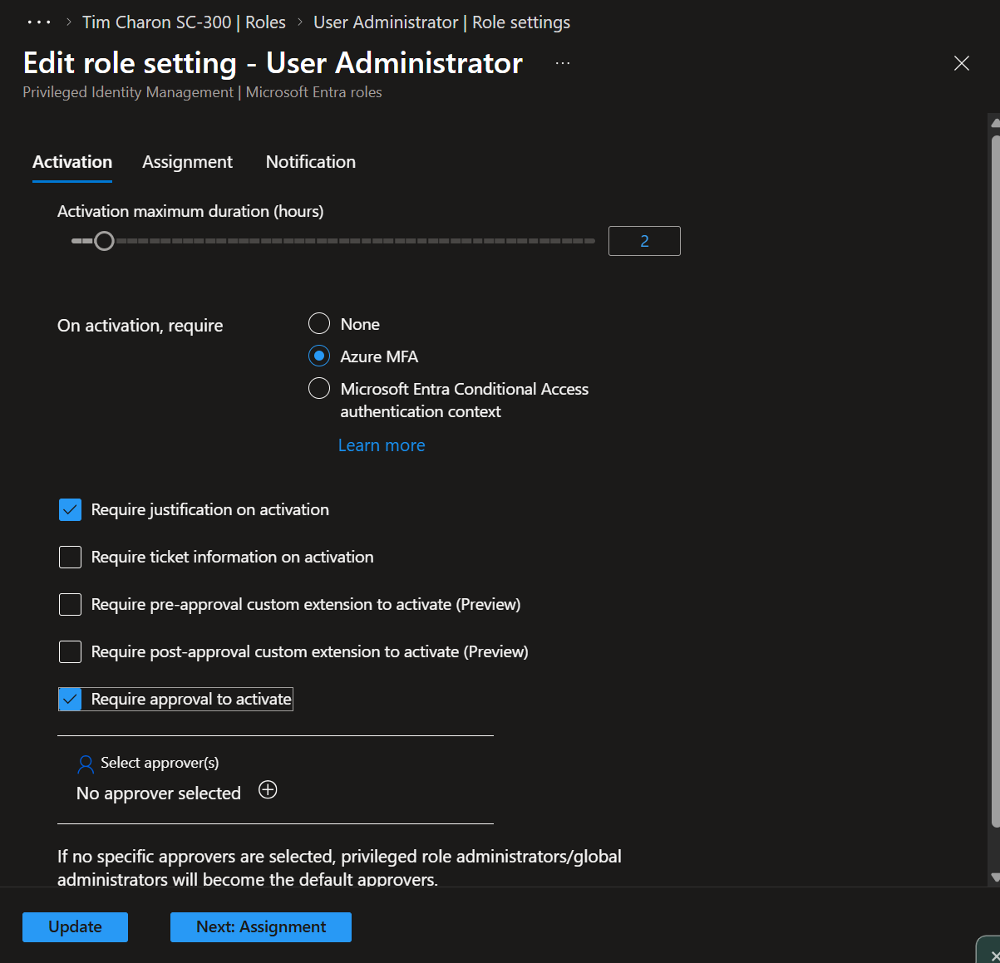
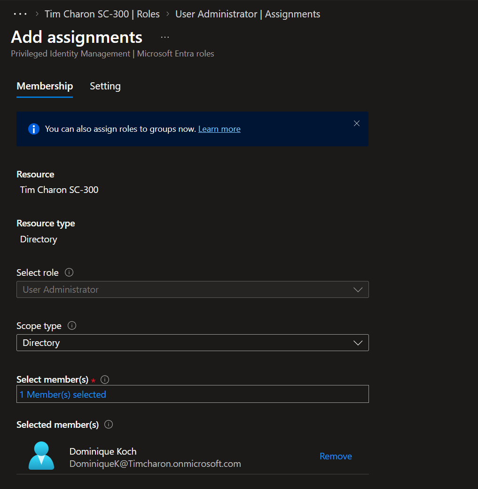
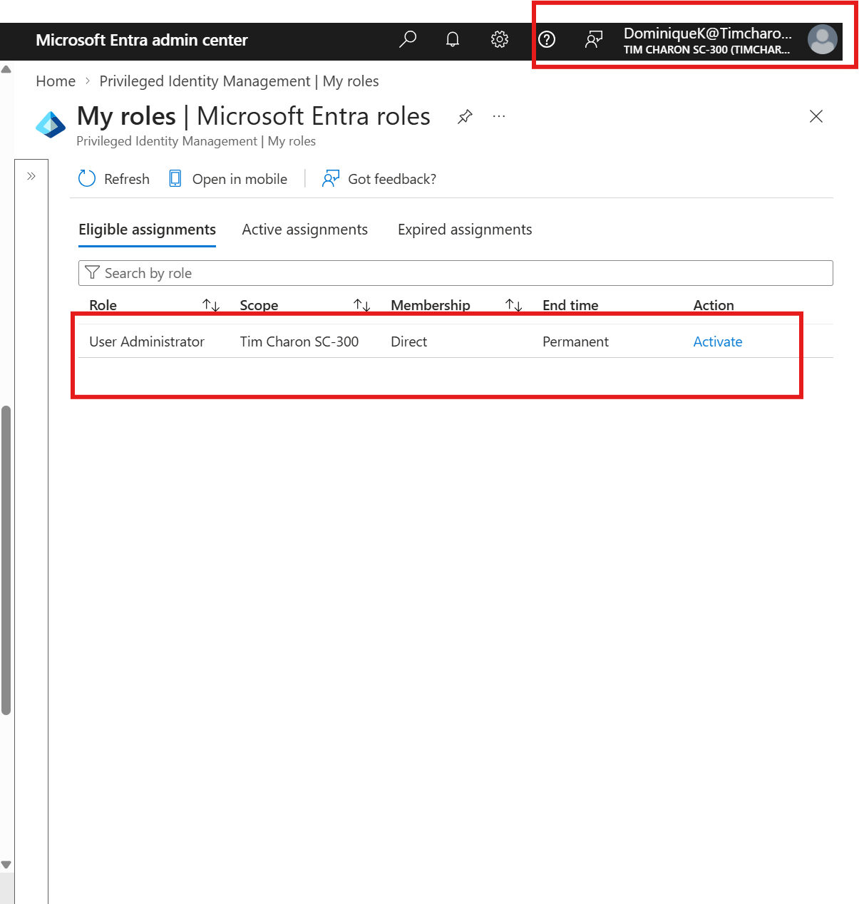
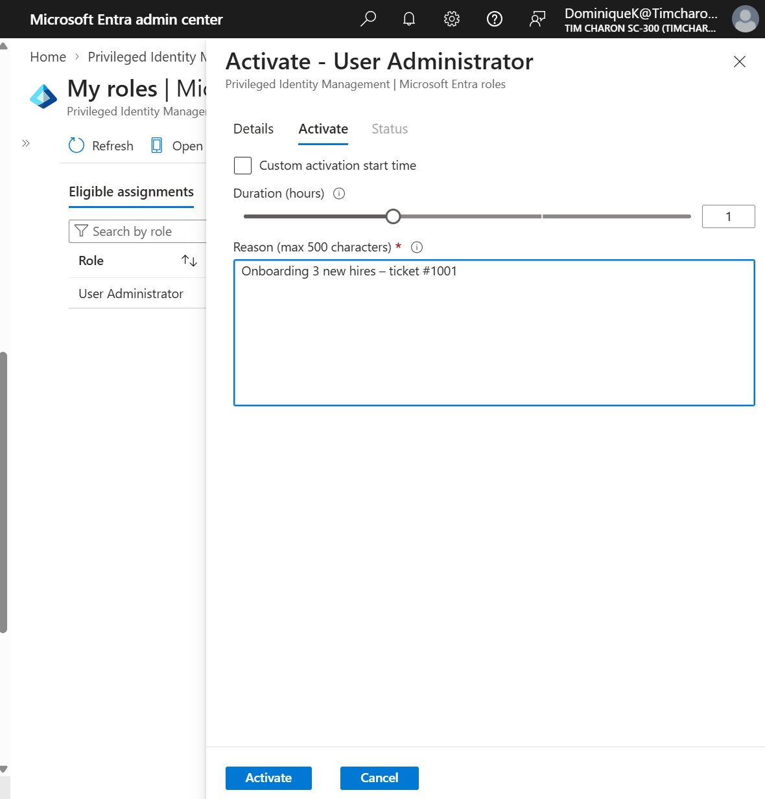
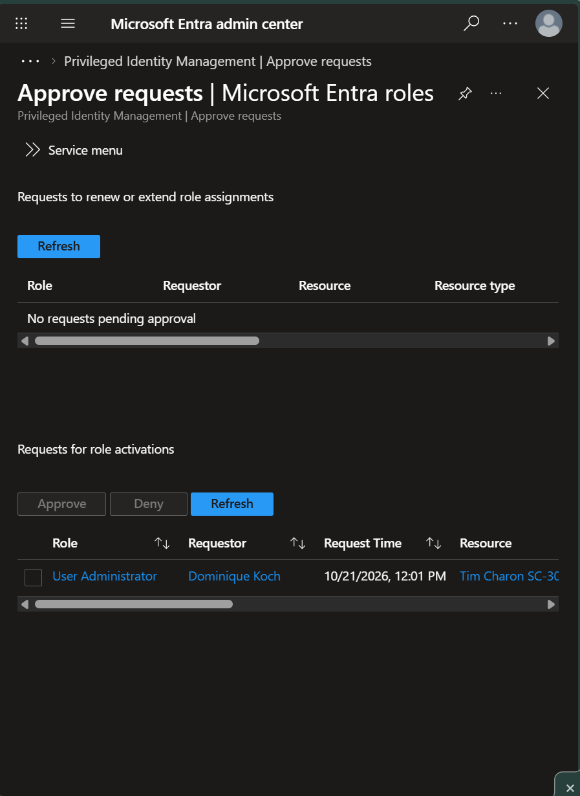
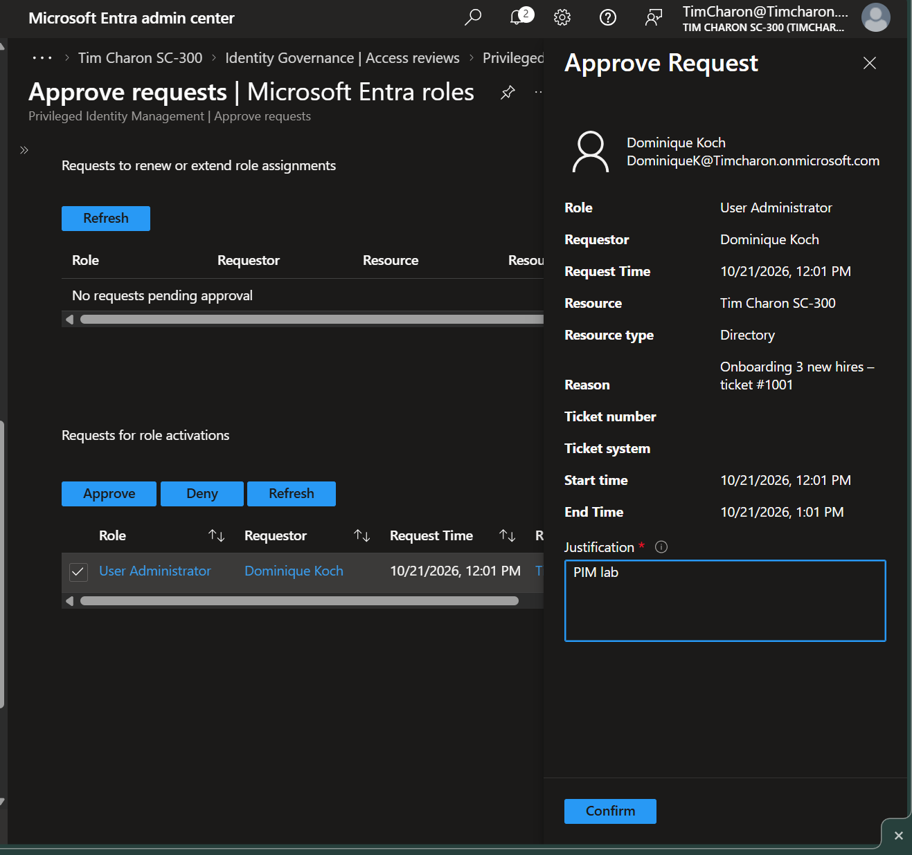
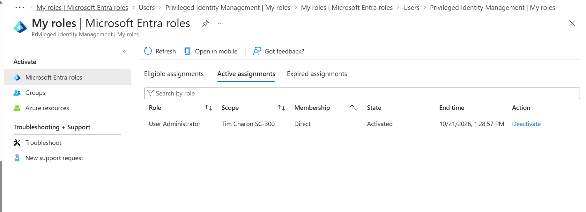
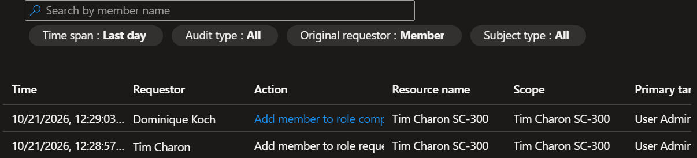

# Just-in-Time Admin Access with Microsoft Entra Privileged Identity Management (PIM)

Hands-on lab in my own Microsoft Entra ID tenant (`Tim Charon SC-300`), built while studying for **Microsoft SC-300: Identity and Access Administrator**. It follows on from my Entra ID identity lab (tenant, users, roles, groups, licensing).

**Goal:** remove standing admin access. Instead of holding the **User Administrator** role all the time, a junior admin is made *eligible* for it and must **activate** it when needed, with MFA, a written reason, and an approver's sign-off. Access ends automatically after a set time.

**Tools:** Microsoft Entra admin center, Privileged Identity Management, Microsoft Entra ID P2 (trial)
**Date:** October 21, 2026

---

## Skills demonstrated

- Configuring PIM role settings (activation duration, MFA, justification, approval)
- Creating an **eligible** (not active) role assignment
- The end-user activation flow from the requester's side
- Reviewing and approving an activation request as an approver
- Verifying time-limited access and its automatic expiry
- Reading the PIM audit trail

## Why it matters

A permanently assigned admin role is a standing target: if that account is phished, the attacker gets the role too. PIM applies **least privilege** and **just-in-time access**. The role is switched off by default, and every use is time-limited, justified, approved, and logged.

| | Active (standing) assignment | Eligible assignment (PIM) |
|---|---|---|
| Role available | Always | Only after activation |
| MFA / reason / approval | No | Configurable per role |
| Expires | Only if an end date is set | Each activation ends automatically |
| License | Free (built-in roles) | Microsoft Entra ID P2 or Entra ID Governance |

---

## Lab walkthrough

### Users in this lab
| Account | Part played |
|---|---|
| **Tim Charon** (Global Administrator) | Configures PIM and approves the request |
| **Dominique Koch** (licensed for Entra ID P2) | Junior admin who needs User Administrator occasionally |

### Step 1: Set the activation rules for User Administrator
**ID Governance → Privileged Identity Management → Microsoft Entra roles → Roles → User Administrator → Role settings → Edit**

On the **Activation** tab:
- **Activation maximum duration:** 2 hours
- **On activation, require:** Azure MFA
- **Require justification on activation:** on
- **Require approval to activate:** on

I didn't choose a specific approver. As the page notes, when no approver is selected, **Privileged Role Administrators and Global Administrators become the default approvers**, so my Global Administrator account handled approvals. Role settings apply **per role**, so every assignment of User Administrator follows these rules.

### Step 2: Make Dominique eligible
**PIM → Microsoft Entra roles → Roles → User Administrator → Add assignments**

Selected Dominique Koch at **Directory** scope, then set the assignment type to **Eligible** on the Setting tab. She can now *request* the role, but she doesn't hold it.

### Step 3: Dominique sees the role as eligible
Signed in as Dominique in a separate private browser window and opened **PIM → My roles → Microsoft Entra roles**. User Administrator shows under **Eligible assignments** (Membership: Direct, End time: Permanent) with an **Activate** link.

### Step 4: Request activation
As Dominique, selected **Activate**, completed the MFA prompt, chose a **1-hour** duration (below the 2-hour maximum), and entered a reason: `Onboarding 3 new hires – ticket #1001`.

### Step 5: The request waits for approval
Back as Tim: **PIM → Approve requests**. Dominique's request (submitted 12:01 PM) appears under *Requests for role activations*.

### Step 6: Review and approve
Opened the request to check the role, requester, scope, and her stated reason before approving. An approver must also enter their own justification.

### Step 7: Confirm the time-limited access
As Dominique: **My roles → Active assignments**. User Administrator is now **Activated**, with an **end time of 1:28:57 PM**, after which it switches off by itself.

**Worth noticing:** the request was submitted at 12:01 PM, but I approved it at 12:28:57 PM, and the end time is **1:28:57 PM**. The one-hour activation window counted from **approval**, not from the request, so time spent waiting for approval didn't eat into her access.

### Step 8: Check the audit trail
**PIM → Microsoft Entra roles → Resource audit.** Two entries show the approval by Tim Charon (12:28:57) and the activation completing for Dominique Koch six seconds later (12:29:03).

PIM's own audit history covers **30 days**. Longer retention requires sending Entra audit logs to Log Analytics, a storage account, or an event hub.

---

## Key takeaways

| Concept | What I learned |
|---|---|
| Eligible vs. active | Eligible means the role must be activated before use; active means it's always on. |
| Role settings | Defined per role and shared by every assignment of that role. |
| Default approvers | With approval required and no approver chosen, Privileged Role Administrators and Global Administrators approve. Approvers don't need an admin role. |
| Activation window | Starts at approval and ends automatically; the eligible assignment stays. |
| Who configures PIM | Privileged Role Administrator is the least-privileged role for Entra role settings. (Not to be confused with Privileged *Authentication* Administrator.) |
| Licensing | Eligible assignments need Microsoft Entra ID P2 or Entra ID Governance. |
| Audit | PIM keeps 30 days of history in Resource audit. |

## Next steps
- PIM for Groups: one activation that grants every role a group holds
- Access reviews of group membership and admin role assignments
- Risk-based Conditional Access with Entra ID Protection
